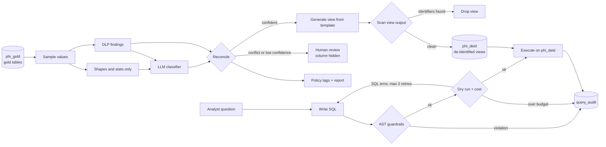

# HIPAA-aware PHI governance and guarded NL-to-SQL analytics

Two LangGraph agents over a healthcare warehouse. The first finds PHI in new tables and
publishes de-identified views. The second answers analysts' questions in plain English and
can only reach those views.

> Personal project on fully synthetic data. It demonstrates de-identification engineering.
> It is not a certified HIPAA system and has not had an Expert Determination.



## Quick start

No cloud account or API key is needed. By default it runs on DuckDB with local stand-ins.

```bash
docker compose up        # then open http://localhost:8501
```

Or without Docker (Python 3.11+):

```bash
python3.12 -m venv .venv && .venv/bin/pip install -e ".[dev]"
.venv/bin/phi-gov load       # 50,495 synthetic rows in 5 gold tables
.venv/bin/phi-gov scan       # run the PHI agent
.venv/bin/phi-gov demo       # blocked query, allowed query, audit log
.venv/bin/phi-gov eval       # measured results
.venv/bin/pytest
.venv/bin/streamlit run app/streamlit_app.py
```

Set `ANTHROPIC_API_KEY` in `.env` to use Claude for classification and SQL. Offline, SQL
comes from a handful of templates, so only those questions work: readmission rate by payer
or diagnosis, denial rate by payer, length of stay, patient counts.

To use the real Project 1 output, export one parquet file per table and run
`phi-gov load --source-dir path/to/gold`. Accuracy results below apply only to the synthetic
schema, because `eval/column_labels.csv` labels those columns.

### Running on BigQuery

```bash
PROJECT=my-project ./scripts/setup_gcp.sh    # service accounts, then two manual grants
# .env: WAREHOUSE_BACKEND=bigquery, DLP_BACKEND=cloud, GCP_PROJECT=my-project,
#       ANALYST_CREDENTIALS_FILE=path/to/analytics-sa.json
phi-gov load && phi-gov scan
# now make the two grants the setup script prints, which need the scan's output
phi-gov demo
```

## How it works

### PHI discovery agent

`discover → sample_and_detect → classify → persist → build_views → verify_views → apply_policy_tags → report`

1. **Discover** finds tables that are new or whose schema hash changed. Unchanged tables are
   skipped.
2. **Detect** samples 50 values per column and runs Cloud DLP.
3. **Classify** sends Claude each column's name, type, format shapes and DLP results, and
   gets back one of 24 categories with a confidence.
4. **Reconcile** applies fixed rules. A detector hit the classifier disagrees with, or
   confidence below 0.7, sends the column to a human.
5. **Build views** generates SQL from code templates using these transforms:

| Data | Tier | Transform | Output |
|---|---|---|---|
| MRN, record keys | Direct | Salted SHA-256 | `mrn_key`, `patient_key` |
| Names, SSN, phone, fax, email, address, city, plan IDs, licences, devices, URLs, IPs, biometrics, photos, free text | Direct | Drop | None |
| Date of birth | Quasi | Year, suppressed if age is over 89 | `birth_year` |
| Age | Quasi | Capped at 90 | `age_capped` |
| Any other date | Quasi | Year | `admit_year` |
| ZIP | Quasi | First 3 digits, `000` for the 17 low-population prefixes | `zip3` |
| Gender, race, language | Quasi | Keep | Same |
| Everything else, including state | Safe | Keep | Same |
| Undecided | Any | Excluded until reviewed | None |

6. **Verify** scans what the finished view actually returns. If identifiers appear, the view
   is dropped.
7. **Tag and report** applies BigQuery policy tags and writes
   [reports/governance_report.md](reports/governance_report.md).

### Guarded analytics agent

`write_sql → guard → dry_run → execute → audit`

Guardrails treat the SQL writer as untrusted. They parse with sqlglot and walk the AST:

- Exactly one statement, and no DML, DDL or parameters anywhere in the tree, including CTEs.
- Every table must be an approved view in `phi_deid`. No raw datasets, wildcards,
  `INFORMATION_SCHEMA`, other projects or table functions.
- No PHI column at any depth. No `SELECT *`, and no whole-row access such as
  `TO_JSON_STRING(t)`.
- Pseudonymous keys only inside `COUNT` or a `JOIN ... ON`. `MAX(patient_key)` would return
  the key, so it is blocked.
- Functions sqlglot does not recognise must be on an allowlist.
- `LIMIT` is added or lowered to 1,000.

What runs is regenerated from the validated AST, not the original string. SQL errors get up
to two retries, and corrected SQL goes back through the guard. A guardrail block is never
retried, because feeding block reasons back would let a model probe around the policy. If
the audit write fails, results are withheld.

## Design decisions

**De-identify instead of only masking.** Masking changes how a column displays, while the
real values stay in the table and one permission mistake exposes them. De-identified views
never produce the values, so a broad grant on `phi_deid` exposes nothing identifying.
Analysts also need stable joins and years, which masking doesn't give them.

**The LLM never sees raw values.** Sending PHI samples to a model is itself a disclosure. The
classifier gets shapes like `(999) 999-9999`, statistics and DLP results. It does worse on
ambiguous columns as a result, and those go to a human. A test asserts that no sampled value
reaches a prompt.

**Human in the loop, failing closed.** The classifier can raise sensitivity alone, but it
can't lower it past a detector hit without a person. Until then the column is hidden. This
costs analysts access to `provider_name` until someone approves it, which is the right
trade: a wrong exclusion is an inconvenience and a wrong inclusion is a breach.

**The LLM picks labels, and code writes SQL.** A model chooses a category. A fixed table maps
that to a transform, and templates produce the view. A confused or manipulated model can
mislabel a column, but it can't write a view.

**Columns are listed explicitly in views.** A column added to a gold table stays hidden until
it is classified. `SELECT *` views would publish schema drift automatically.

**Authorized views do not bypass policy tags.** BigQuery enforces column-level security
through authorized views, so the analytics account needs Fine-Grained Reader on the tags of
the columns views transform. It gets those tags and not `direct_identifier`, so columns the
views drop stay unreadable even to that account.

**Guardrails are the second boundary.** IAM is the first. The analytics service account has
no access to `phi_gold`, and the guard exists for when IAM is misconfigured, and to give
clear errors. Locally there is no IAM, so the read-only connection is the backstop.

**`readmitted_30d` lives in gold.** Safe Harbor removes exact dates, so a 30-day window can't
be computed in the de-identified layer. Metrics needing dates are computed upstream.

## Measured results

From `phi-gov eval`, stored in [eval/results/](eval/results/). Reproduce with that command.

**Environment:** DuckDB, local regex detector, offline rule classifier. **These are not
Claude or Cloud DLP numbers.**

| Measure | Result |
|---|---|
| Hostile queries blocked | 103 of 103 |
| Legitimate queries allowed | 15 of 15 |
| Tests passing | 180 |
| Gold rows / tables / columns | 50,495 / 5 / 71 |
| Load + scan runtime on a laptop | 2.6s load, about 3.6s scan |

| Classifier eval (71 hand-labelled columns) | Normal | Column names hidden |
|---|---|---|
| PHI precision | 100% | 90.5% |
| PHI recall | 100% | 42.2% |
| 3-class accuracy | 100% | 60.6% |
| Columns sent to review | 2 | 50 |
| **PHI columns exposed in views** | **0** | **0** |

How to read these:

- **The 100% column isn't evidence of skill.** The offline rules were written while looking
  at these same columns, so they are overfit by construction.
- **The right-hand column is the honest one for the offline rules.** Without names they
  recognise under half the PHI, and yet nothing is exposed, because what they can't
  identify goes to review. That is the fail-closed design working.
- **The guardrail corpus was written by the guardrail's author.** It shows the listed attacks
  are stopped, not that no attack exists. The first round passed 70 of 70, so a second,
  harder round was written. It found four gaps in the guard: DML inside a CTE, query
  parameters and system variables, PHI hidden in a struct path, and `current_database()`.
  None exposed patient data, and all are fixed and kept in the corpus.

## Known limitations

- **Salted hashes are pseudonyms.** Safe Harbor doesn't allow a re-identification code derived
  from the identifier, so strictly these views are a limited-data-set style output. A random
  token map held in the restricted dataset would be the stricter choice.
- **No small-cell suppression.** A rare diagnosis in a small ZIP3 and birth year can single
  someone out, and repeated queries can difference out individuals. A real deployment would
  suppress counts under a threshold such as 11.
- **The guard can't see intent.** Key rules stop keys being returned, but `COUNT` with a
  condition on a key could in principle be used as a slow oracle.
- **No real authentication.** The analyst name in the UI is free text, so the audit log's
  `user_name` is only as good as what is typed.
- **Questions are logged as typed.** An analyst can type PHI into a question, so
  `phi_governance` must stay restricted.
- **Review is CLI only**, and there is no re-identification risk scoring.
- **Quasi-identifiers stay queryable at row level**, within the row limit.

## Project layout

```
src/phi_gov/discovery/   hipaa.py policy table, detectors, classifier, deid views, agent
src/phi_gov/analytics/   guardrails, SQL writers, agent
src/phi_gov/warehouse/   DuckDB and BigQuery backends behind one interface
src/phi_gov/synthetic.py gold layer covering all 18 identifiers, plus traps
eval/                    labelled columns, attack corpus, results
app/                     Streamlit UI
tests/                   deid, discovery, guardrails, analytics, API contracts
```
